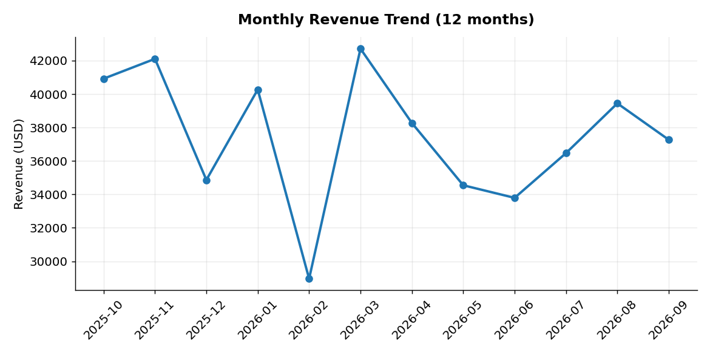
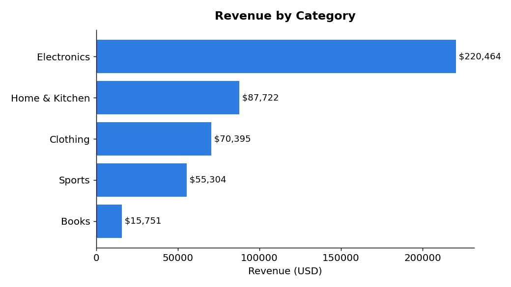
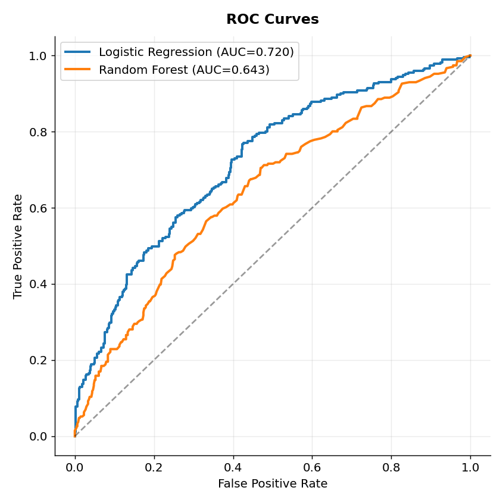
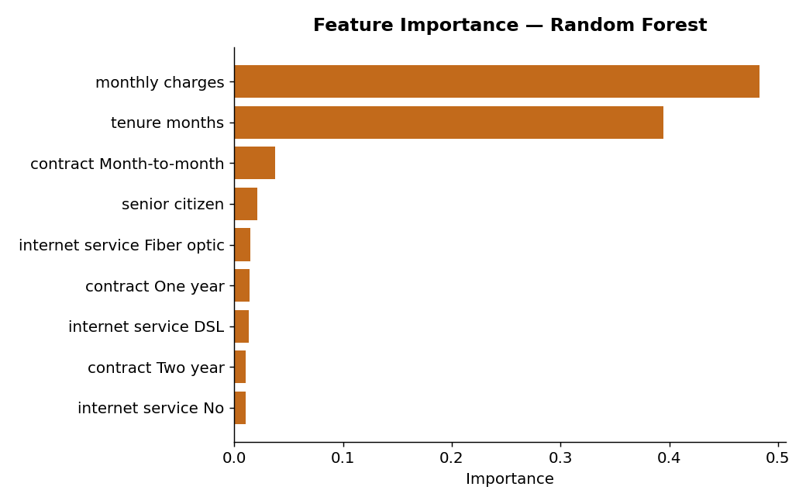
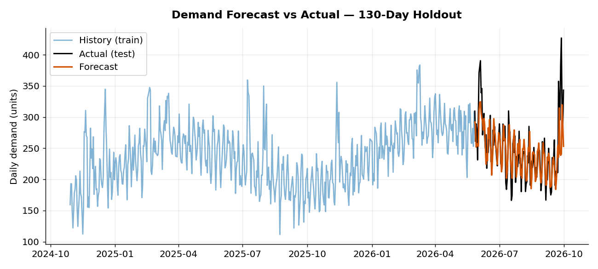
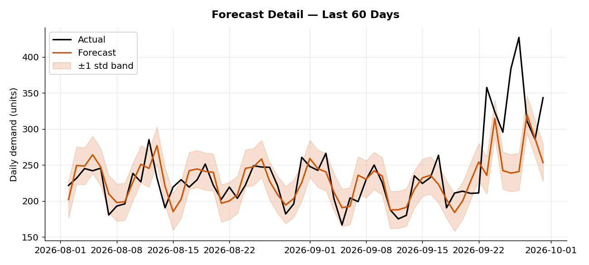
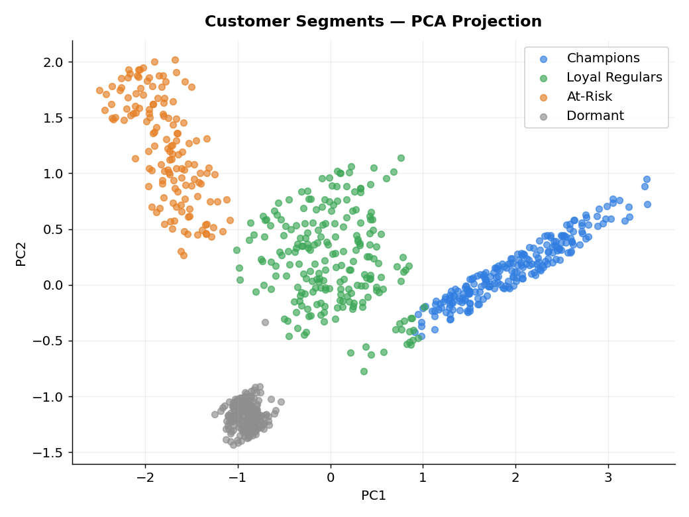
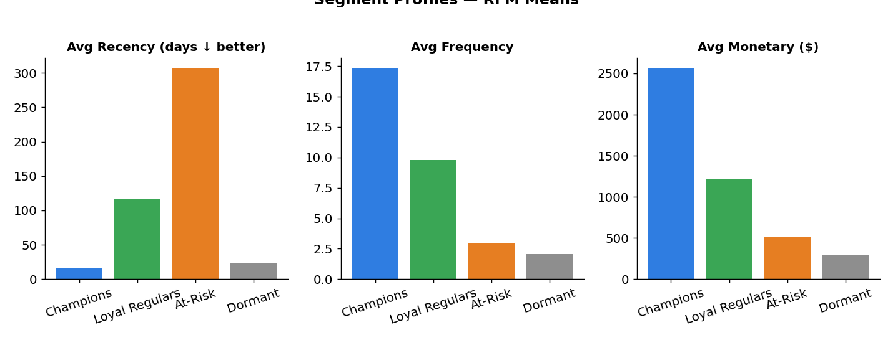
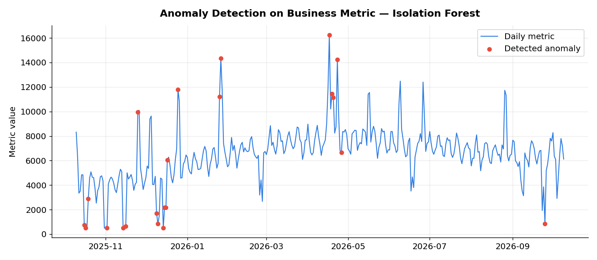
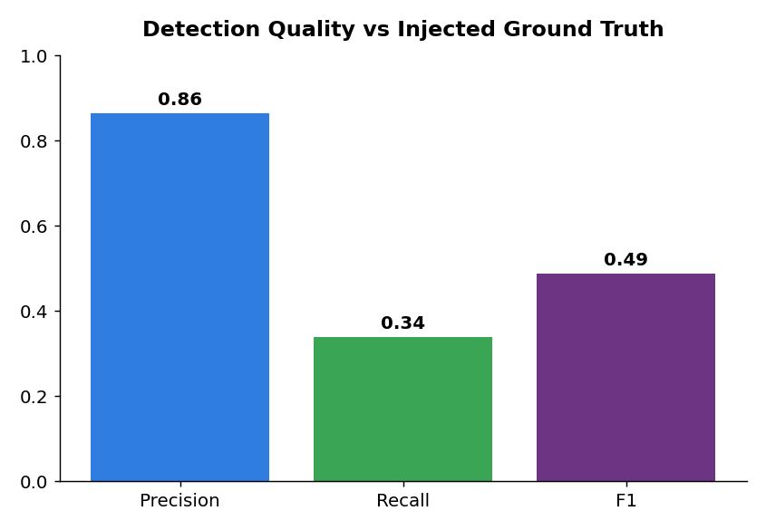

# Data Science Portfolio

Hi! I'm a data scientist working mostly in Python. This repo holds sample projects
that show how I approach data analysis and machine learning — from cleaning messy
data to building models and communicating what the numbers actually mean.

## Projects

### 1. E-commerce Sales Analysis (`sales_eda.py`)
End-to-end exploratory analysis of 2,000 orders across 12 months: revenue trends,
category breakdown, top products, and customer-segment mix — with plain-language
takeaways.




### 2. Customer Churn Prediction (`churn_ml.py`)
Built and compared two churn-prediction models (Logistic Regression vs Random Forest)
on a 3,000-customer dataset: preprocessing pipeline, stratified train/test split,
precision/recall/F1 and ROC-AUC comparison, confusion matrix, and feature importance.




### 3. Demand Forecasting (`demand_forecast.py`)
Time-series forecasting on 2 years of daily demand: lag/rolling features with
gradient boosting, 130-day holdout evaluation (MAPE 9.2%), and error bands.




### 4. Customer Segmentation (`customer_segmentation.py`)
RFM segmentation of 800 customers with K-Means: four actionable segments
(Champions, Loyal Regulars, At-Risk, Dormant) with PCA visualization and profiles.




### 5. Anomaly Detection (`anomaly_detection.py`)
Isolation Forest on a year of business metrics: flags unusual spikes/drops,
evaluated against injected ground truth (precision 0.86).




## Tools
Python, pandas, NumPy, scikit-learn, Matplotlib

## Reproduce
```bash
pip install -r requirements.txt
python sales_eda.py
python churn_ml.py
python demand_forecast.py
python customer_segmentation.py
python anomaly_detection.py
```

*Note: datasets are synthetic (generated with fixed random seeds) for demonstration.*
